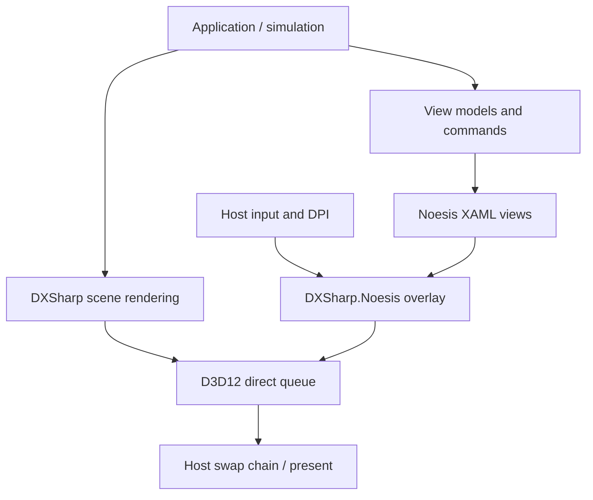

<p align="center">
  
</p>
<h1 align="center">DXSharp.Noesis</h1>
<p align="center"><strong>Native Direct3D 12 rendering meets declarative XAML user interfaces.</strong></p>
<p align="center">
  <a href="https://github.com/atcarter714/DXSharp">DXSharp SDK</a> ·
  <a href="https://www.noesisengine.com/">NoesisGUI</a> ·
  <a href="https://github.com/atcarter714/DXSharp.Noesis/actions">Builds</a> ·
  <a href="https://github.com/atcarter714/DXSharp.Noesis/issues">Issues</a>
</p>
<p align="center">
  
  
  
  
  <a href="LICENSE"></a>
  
</p>

## Overview

DXSharp.Noesis is an independent integration library for building GPU-accelerated interfaces in .NET applications using [DXSharp](https://github.com/atcarter714/DXSharp) and NoesisGUI. It brings XAML-based UI composition, data binding, animation and input to native D3D12 applications while leaving the application's rendering architecture under its own control.

Designed for game developers, graphics engineers and technical artists building interactive simulations, tools, game interfaces and custom engines. It is not a game engine, a replacement for NoesisGUI, or a mandatory dependency of the core DXSharp SDK.

> [!NOTE]
> This repository is experimental. `main` contains the integration foundation and initial showcases. The [active showcase branch](https://github.com/atcarter714/DXSharp.Noesis/tree/feature/worldspace-ui-studio) contains the newer astronomical renderer, calibrated cockpit, flight controls and MVVM work described below. Features on that branch are subject to Windows/GPU qualification before release.

## What it provides

| Capability | Current scope |
| --- | --- |
| Rendering integration | Noesis view and D3D12 render-device management, stencil surface and UI command recording |
| Frame lifecycle | Host-controlled graphics device, swap chain, frame synchronization and resize |
| Input | Scene/UI hit testing, pointer ownership, keyboard and DPI-aware routing |
| Authoring | Shared runtime XAML and standalone Noesis Studio project descriptors |
| MVVM | Data binding and commands; CommunityToolkit.Mvvm command adapter on the development branch |
| Verification | Executable XAML, input, DPI, simulation and mesh checks; optional GPU smoke tests |

## Interactive showcases

### Orbital Command — Kepler Anchorage

A sci-fi command interface over a real-time 3D orbital scene. Manage a small fleet, issue survey and patrol orders, inspect vessel telemetry, and manipulate the scene camera through a Noesis dashboard.

The development branch adds an independent **3D SOL** view with an advancing astronomical clock, heliocentric positions, planet focus, adjustable radius exaggeration and JPL fitted planetary elements or cached Horizons position/velocity samples. The planar SOL atlas remains a separate reference view. Current 3D planetary surfaces and sky are procedural; the atlas supports downloaded astronomical artwork.

[Source](samples/OrbitalCommand) · [Astronomy and showcase guide](https://github.com/atcarter714/DXSharp.Noesis/blob/feature/worldspace-ui-studio/docs/showcase-astronomy.md)

### Starfighter — Vanguard

A cockpit-based asteroid-intercept showcase combining a native D3D12 scene with XAML flight instruments, targeting and telemetry.

The development branch adds an imported cockpit mesh calibrated to the fighter coordinate frame, independent pilot head-look, inertial translation and a bounded angular-rate flight controller. The flight model is flight-assisted rather than a complete rigid-body simulation. Textured PBR materials and interactive world-space instruments remain future work.

[Source](samples/Starfighter) · [Flight controls and cockpit calibration](https://github.com/atcarter714/DXSharp.Noesis/blob/feature/worldspace-ui-studio/docs/showcase-astronomy.md)

## Getting started

**Requirements:** Windows x64, .NET 10 SDK, a Direct3D 12-capable system and PowerShell. Visual Studio 2026 is suitable for opening the solution; Windows Graphics Tools are recommended for debug-layer tests.

```powershell
git clone https://github.com/atcarter714/DXSharp.Noesis.git
cd DXSharp.Noesis

# Optional: use the active showcase development branch
git switch feature/worldspace-ui-studio

pwsh -File eng/build.ps1
dotnet run --project samples/OrbitalCommand -c Release --no-build
dotnet run --project samples/Starfighter -c Release --no-build
```

Open `DXSharp.Noesis.slnx` to build or debug individual projects. The build script restores, builds, runs verification and packs the integration library locally. No local DXSharp checkout or private package feed is required. Review generated NuGet lockfiles before enabling locked restore.

| Dependency | Baseline |
| --- | --- |
| DXSharp.Core | 0.4.0-preview.3 on the original main baseline; 0.4.0-preview.4 on the showcase branch |
| Noesis.GUI | 4.0.1.18263 |
| Noesis.App | 4.0.1 |
| CommunityToolkit.Mvvm | 8.4.2 on the showcase branch |

The authoritative versions are in [Directory.Packages.props](Directory.Packages.props).

### Noesis licensing

NoesisGUI is separately licensed. Configure `NOESIS_LICENSE_NAME` and `NOESIS_LICENSE_KEY` in your local environment for licensed execution. Without credentials, the runtime may operate in trial mode and stop rendering after the evaluation interval. Do not commit credentials or vendor SDK archives.

### Optional astronomical data

On the showcase branch, use a local Python environment to prepare the optional atlas assets and ephemeris range:

```powershell
python -m venv .venv
.\.venv\Scripts\python.exe -m pip install numpy Pillow
.\.venv\Scripts\python.exe eng/assets/fetch-horizons.py --days 365
.\.venv\Scripts\python.exe eng/assets/prepare-solar-art.py --download
```

The default offline fitted-element mode does not require network access. See the astronomy guide for provenance, epoch handling and rendering limitations.

## Architecture



The host owns process-wide Noesis initialization, graphics-device and swap-chain lifetime, frame scheduling and presentation. The overlay owns its Noesis view, renderer and stencil resources. Drain outstanding GPU work before resizing or disposing the overlay; submit scene rendering before the UI on the same direct queue.

| Directory | Responsibility |
| --- | --- |
| [src/DXSharp.Noesis](src/DXSharp.Noesis) | Reusable render and input integration |
| [samples/OrbitalCommand](samples/OrbitalCommand) | Orbital command and astronomy showcase |
| [samples/Starfighter](samples/Starfighter) | Cockpit and flight showcase |
| [tests/Verification](tests/Verification) | Managed/native UI and simulation regression checks |
| [eng](eng) | Build, packaging and validation automation |

## Noesis Studio and verification

Open `samples/OrbitalCommand/Ui/OrbitalCommand.noesis` or `samples/Starfighter/Ui/Starfighter.noesis` in a compatible separately installed Noesis Studio 4.0.1. These descriptors reference the same XAML used at runtime. Standalone authoring and embedded editor integration are separate milestones; runtime-only resources and data contexts may need design-time configuration.

```powershell
dotnet run --project tests/Verification -c Release
pwsh -File eng/build.ps1 -Locked -Smoke
```

Use locked mode only after reviewing and generating lockfiles for the selected branch. GPU smoke tests need a suitable Windows environment. Test resize, DPI, pointer capture, frame retirement and shutdown on the actual target adapter.

## Roadmap

- [x] D3D12 overlay and independent sample hosts
- [x] XAML authoring entry points and verification foundation
- [ ] Reusable render-to-texture / world-space XAML views and ray-based input
- [ ] Interactive cockpit multifunction displays and independent view lifetimes
- [ ] Optional Noesis Studio integration and reusable hosting components
- [ ] Textured materials, astronomical skybox and showcase polish
- [ ] Release qualification, API documentation and public package distribution

## Documentation and ecosystem

[Architecture](docs/architecture.md) · [Dependencies](docs/dependencies.md) · [Validation](docs/validation.md) · [Studio integration](docs/studio.md)

| Project | Purpose |
| --- | --- |
| [DXSharp](https://github.com/atcarter714/DXSharp) | Modern .NET / DirectX SDK and GPU workload infrastructure |
| **DXSharp.Noesis** | XAML interfaces and interactive graphics integration |
| [DXSharp.Houdini](https://github.com/atcarter714/DXSharp.Houdini) | Procedural authoring, geometry interchange and Houdini integration |

## License and credits

The integration and samples are provided under the [MIT License](LICENSE). NoesisGUI, DXSharp, Microsoft dependencies and third-party artwork retain their respective terms. No proprietary vendor SDK distributions are included.

The development branch's cockpit is derived from [Spaceship 001 - Cockpit Concept](https://sketchfab.com/3d-models/spaceship-001-cockpit-concept-a699d0978ece4c7d8dc6cc650e19a9aa) by Mixmamo.studio, licensed under [CC BY 4.0](https://creativecommons.org/licenses/by/4.0/). Astronomical data and atlas imagery are credited in the showcase guide and asset provenance files.

Maintained by **Arkaen Solutions**. Contributions and reproducible issue reports are welcome; please include the branch, package versions, OS, GPU and relevant logs.

The public integration is independent of proprietary Arkaen projects and content.
